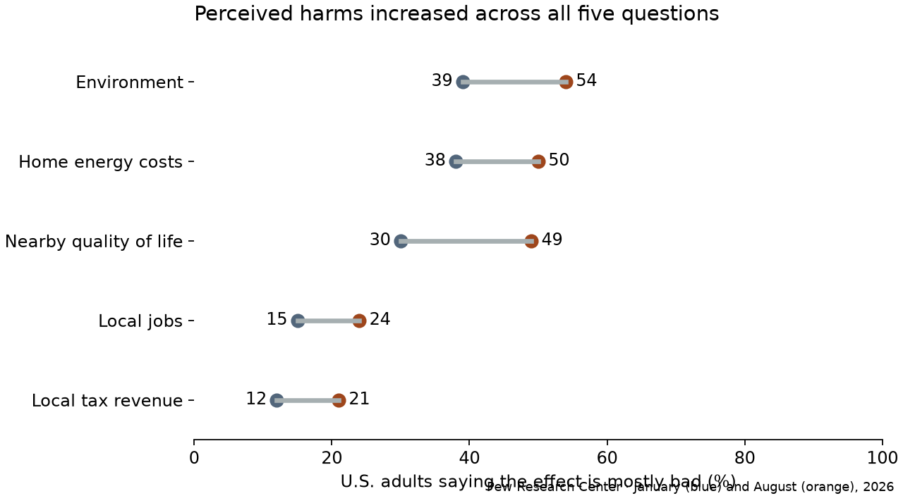
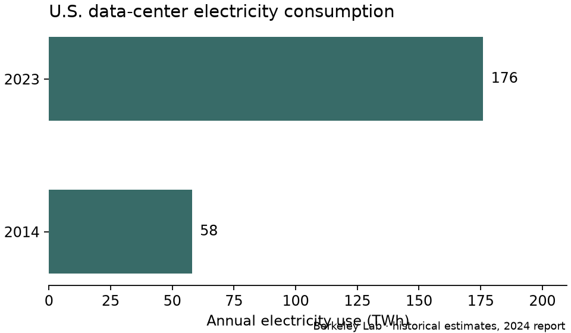

# Who is the wizard behind the curtain?

**Research brief for a Toastmasters discussion of AI, economic power, and fairness**  
Evidence through November 8, 2026.
Working proposition: expanding U.S.
AI data-center capacity would be good for the country.
Working purpose: invite listeners to investigate what shapes their response, who gets to decide, and who gains under either outcome.

A community can reasonably want the benefits of computing, object to the terms of a particular project, and worry that a construction ban will strengthen firms that already own capacity.
Those positions can coexist.
The evidence establishes widespread local opposition, growing concern about several consequences, and considerable variation in who gains.
It leaves the extent of any national slowdown, and the identity of anyone directing public anger, open.

## Oz and the ownership question

In Henry Littlefield’s 1964 interpretation of Baum’s 1900 novel, the farmer and industrial worker travel to the seat of power.
The silver shoes on the gold road evoke the fight over which metals could back the currency.
For indebted farmers, falling crop prices could mean selling more of a harvest to repay the same dollar debt.
A technical rule shaped who could keep a farm.
This is an interpretation of the book; Baum’s purpose remains disputed.
[1]

The comparison worth testing today concerns ownership.
AI and robotics require capital that relatively few organizations can mobilize at scale.
If owning machines, compute, or access to customers gives those owners bargaining power, productivity gains could concentrate.
Lower prices, wider access to computation, and gains to workers who use the tools are also possible.
Evidence about data centers alone cannot settle the distributional effects of robotics.
The Oz question directs attention to the particular decision someone controls: financing a campus, approving a site, setting electricity terms, or persuading voters.
Each requires different evidence.

## What did the election express?

Democrats won control of Congress and gained governorships in the 2026 midterms.
Texas elected Democrat Gina Hinojosa governor and Clayton Tucker agriculture commissioner.
Tucker publicly credited his opposition to data-center development with helping him win.
His account establishes a campaign theme; estimating its effect on his margin would require additional evidence.
Among voters under 30, roughly three-quarters supported their local Democratic House candidate and about six in ten cited expressing opposition to Trump as one reason for their vote.
Voters could have several motives.
[2, 3]

The AP Voter Poll provides a more direct test than the color of an election map.
Roughly three-quarters of voters opposed a new data center in their community.
About one-quarter described AI data centers as crucial to their congressional vote.
Cost of living and corruption ranked higher.
Majorities opposed nearby development in red and blue states.
The poll supports an electoral constituency for scrutiny, including outside the Democratic coalition.
It does not identify how many votes changed sides because of the issue.
Nor does a national election result count how many projects were canceled.
[2]

A slowdown is plausible where newly elected officials can change tax incentives, permitting, or utility rules.
A local moratorium may delay one site while demand moves elsewhere.
To measure the shift, follow projects from proposal through permission, grid connection, and operation.
Compare megawatts actually brought online before and after policy changes with similar places, accounting for preexisting grid queues, construction lead times, and demand.
The election is too recent for such an outcome estimate here.
[2, 8, 9]

## What people say, and what the questions measure

*Figure 1. Percent of U.S. adults rating each effect mostly bad. Quality of life nearby shows the largest descriptive change, from 30% to 49%. Opinion about local tax revenue also worsened, though only 21% rated that effect mostly bad in August. Estimates are rounded survey aggregates.* [4]

The age gradient is visible but the movement is broader.
From January to August, the environmental measure rose from 54% to 64% among ages 18–29 and from 26% to 42% among ages 65 and older.
The same measure rose from 31% to 47% among Republicans and Republican leaners and from 50% to 62% among Democrats and Democratic leaners.
Urban respondents went from 41% to 51%, suburban respondents from 43% to 58%, and rural respondents from 32% to 50%.
These are differences among population groups.
A rural national average cannot characterize a particular Texas county.
[4]

Annenberg found 70% of respondents under 30 opposed a facility in their area.
Gallup found people volunteer environmental concerns and, among supporters, employment opportunities.
Question design matters: a prompted list makes an issue salient; an open response reveals what comes to mind first.
A local siting question elicits a different judgment from a national industrial-policy question.
The studies cover different dates and populations: AP surveyed voters, Pew surveyed adults, and Annenberg surveyed adult citizens.
Keep their denominators separate.
Figure 1 compares the same publisher’s repeated measures.
It does not track individual changes of mind, provide subgroup uncertainty intervals, or measure hatred.
[2, 4–6]

**Economic exclusion is a hypothesis about meaning.** Americans widely perceive homeownership and saving as harder for young adults than for their parents.
Pew also documents rising house prices relative to young adults’ incomes.
In a separate survey, young adults voiced concern about AI and jobs.
A young voter might reasonably ask what a promise of national prosperity offers someone struggling to afford a home or start a family.
Neither survey links that person’s housing experience to their data-center opinion.
Other explanations include concern about privacy, job security, local control, and direct exposure to a proposed site.
The speaker’s conversations motivate that question; they supply no prevalence estimate.
[7, 15]

## Physical costs, economic benefits, and who bears them

*Figure 2. Berkeley Lab estimates annual U.S. electricity consumption by all data centers, including conventional computing. Its 2024 report estimates 58 TWh in 2014 and 176 TWh in 2023. These historical estimates explain why grid planning matters. They do not quantify the effect on an individual electric bill. The lab’s subsequent update projects 649 TWh in 2030 under its reference assumptions; that figure is a scenario.* [10, 11]

**Electricity.** Capacity to serve peak demand has a cost even if the expected customer uses less.
Ohio’s 2025 AEP tariff assigns covered large customers a minimum bill based on capacity they reserve.
A utility customer, a taxpayer, and an investor can be the same person, but these are three different ways a household might bear costs.
General claims that taxpayers usually pay require a national accounting of subsidies, contracts, and losses that these sources do not supply.
[9]

**Water and land.** Virginia’s legislative review found most facilities there used water at or below the scale of a large office building, with sizable exceptions.
Cooling design, local supply, and proximity to residents matter.
Quiet statewide averages can coexist with a binding local constraint or persistent noise next door.
A fair local assessment would include seasonal withdrawals and consumption, cooling design, noise at homes, and what the same land and water could support otherwise.
[8]

**Jobs and taxes.** Virginia’s review reports an illustrative peak construction workforce of about 1,500 and about 50 continuing workers at a typical 250,000-square-foot site, based on industry interviews.
Across five mature markets, data-center revenue ranged from under 1% to 31% of local revenue.
Virginia also granted about $928 million in equipment sales-tax savings in fiscal 2023.
A state exemption and local property-tax receipts accrue to different budgets.
Estimating a net fiscal gain requires knowing what would have been built under different terms.
[8]

The polls and the physical evidence address different scales and dates.
It would be misleading to correlate national attitudes in 2026 with national electricity use in 2023 and infer causation.
The comparison shows which fears have a measurable counterpart, where an impact is local, and where a forecast is doing the work.

## Who owns capacity, and who can change its value?

Amazon, Microsoft, and Google have the broadest U.S. hyperscale footprints.
Some facilities are operator-owned, others leased.
Industry researcher Synergy reports that over half of worldwide hyperscale capacity was in operator-owned facilities in its 2025 analysis.
That global percentage cannot be converted into a U.S. ownership share.
The owner of the site, the tenant controlling energized space, and the seller of compute can each capture a different part of its value.
Digital Realty disclosed that GI Partners acquired a 65% stake in two operating Chicago-area hyperscale buildings.
Its filing identifies local availability as a factor in rents at renewal.
These are direct reasons to take the incumbent advantage seriously.
[12–14]

| Trajectory | Who could gain | Who bears costs or forgoes gains | What would distinguish the outcomes? |
| --- | --- | --- | --- |
| Build rapidly; demand holds | Developers, construction workers, equipment suppliers, compute customers, tax-collecting localities | Neighbors exposed to noise or competition for water; households exposed under particular utility contracts | Occupied capacity, actual tax receipts, bills by customer class, local use of water |
| Build rapidly; demand disappoints | Customers may obtain cheaper capacity; beneficiaries of construction already earned income | Equity investors, lenders, and whoever guaranteed capacity or grid upgrades | Write-downs, lease obligations, minimum bills, stranded-cost rulings |
| Slow construction; demand holds | Holders of scarce powered space or long leases may earn higher rents or margins; communities can bargain for better terms | New entrants, customers needing compute, displaced workers, owners unable to expand | Rental renewals, cloud prices, utilization, permits and capacity in substitute markets |
| Stop locally; demand relocates or falls | Residents may retain land, water, and grid headroom; another region may gain investment | Host loses potential tax receipts and jobs; a receiving community may inherit burdens | Destination of canceled projects, realized local revenue, land reuse, avoided upgrades |

These are conditional mechanisms.
A broad freeze can simultaneously protect an incumbent from entry and constrain its own growth.
A landlord with a fixed lease may capture a scarcity premium only at renewal; a tenant may capture value sooner through the services it sells.
The benefit could vanish if customers can substitute locations, efficiency improves, or demand falls.
The $7 trillion figure discussed during topic development was a hypothetical stake.
The sources here do not establish it as committed U.S. spending.
[8, 9, 12–14]

## Who is trying to shape opinion?

Food & Water Watch publicly convened more than 500 groups seeking a national moratorium, citing local environmental harms and broader concerns about jobs and corporate power.
Its letter documents an organizer, a policy demand, and stated motives.
On the expansion side, developers benefit from approvals, and industry representatives told Virginia’s reviewers that tax treatment influences where they build.
Public officials and regulators have formal authority that neither campaign can exercise alone.
An actor’s financial exposure, an attempt to influence policy, and successful persuasion are three separate claims.
Demonstrating the last would require evidence such as lobbying disclosures, campaign spending linked to specific messages, meeting records, and changes in attitudes following exposure.
No evidence assembled here establishes that owners of existing capacity secretly organized opposition.
[8, 9, 16]

### Oregon, Ohio: who paid to keep a project alive?

Jim and Laura Davis began by talking with friends and family about a proposed Vantage data center near Toledo.
After retiring, they joined United Neighbors of Oregon and helped gather signatures.
Petitioners secured a vote on Issue 25, a charter amendment prohibiting construction of facilities with aggregate monthly demand or peak load above 25 megawatts.
Their organizing changed who could make the decision: every city voter could now weigh in.
[18, 19]

**The money.** Vantage gave $250,000 to Opportunity on the Bay to defeat the amendment. Four union groups contributed a combined $85,000 to a separate committee, Building Our Future Ohio, on the same side.
Keeping the site available served the developer’s commercial interest; construction work also gave labor a plausible stake.
Supporters of the restriction reported raising $4,600. The disclosed comparison is about 73 to 1 in contributions. The figures come from Cleveland.com’s reporting on county campaign-finance records. That account does not identify the individual donors behind the $4,600 or establish either side’s final advertising expenditures.
[17]

**The decision.** On November 3, voters approved the cap.
The preliminary tally was 4,994 for and 3,235 against.
On November 5, Vantage told local station WTVG that its project would not proceed as proposed.
That statement connects a ballot decision to an actual development decision.
Whether the company will build equivalent capacity elsewhere is a separate question.
[18, 19]

For the fairness discussion, different people exercised different kinds of power.
Vantage and the unions could finance a campaign.
The neighbors could put a question on the ballot.
Voters could adopt a binding rule, and the developer could decide where to invest next.
The vote establishes that the better-funded side lost.
How many minds either campaign changed, or whether anyone who already owned capacity benefited, remains unknown.
[17–19]

### Storey County, Nevada: an incumbent tried to restrict a competitor

Switch operated the Tahoe-Reno 1 data center at its Citadel campus.
When it negotiated its land purchase in 2015, it secured a covenant limiting how other parcels in the industrial park could be used.
The district judge identified two interests behind that deal: reliable access to scarce power and water, and an advantage over potential competitors.
When Tract acquired land for data-center development in 2023, Switch went to court in its own name to enforce the restriction.
Here the incumbent, its existing capacity, the instrument it used, and the competitor it sought to constrain are all identifiable.
The materials reviewed do not disclose Switch’s legal spending or any payment to a citizens’ group.
[20, 21]

The October 2025 district court ruling distinguished operating a competing multi-tenant facility, which rents capacity to multiple customers, from preparing land that could later host a permitted use.
The covenant restricted the former on the Peru Shelf parcels.
Tract could continue preparing the site.
Switch therefore retained a specific competitive protection but failed to obtain the broader restriction it sought.
This is evidence that an incumbent acted to limit entry.
The order supplies no estimate of extra revenue for Switch or change in computing prices.
[20, 21]

### Osawatomie, Kansas: donors financed a fight for a vote

In Osawatomie, residents pursued a local ordinance to prohibit high-impact data centers while the city was considering a campus.
Their petition was certified.
When the city did not put the question to voters, residents sued for ballot access.
Their attorney defense fund publicly solicited donations for that action.
Its platform lists, among other gifts, $50 from Dale and Donna Koontz Goddard and $50 from Karen Daulton.
These are identifiable contributions toward a specific legal objective.
The fundraiser supplies donor display names and amounts; it does not establish employment, beneficial ownership, or a complete account of litigation finance.
The documented milestone is a certified petition and a legal challenge.
The cited records establish neither a successful ban nor cancellation of the campus.
[22, 23]

Across the two cases, the public trail reaches different endpoints.
In Nevada it leads directly to an operator exercising a contractual right against a potential rival.
In Kansas it leads to named donors supporting residents’ legal action.
I found no documented transfer from an incumbent operator to that campaign or to the Oregon restriction supporters described above.
A disclosed contribution, paid invoice, grant agreement, or attributable testimony connecting an operator to the local effort would change that assessment.
[17, 20–23]

For the speech, the most revealing question may be: **If the next data center is stopped, who gains because they already control the last one?** Pair it with the converse: **If it is built, who gets a return and who has agreed to absorb the downside?** A principled assessment asks whether those exposed to risk had a voice, whether promised benefits are enforceable, and whether the people empowered to decide share the consequences.
The audience can apply those questions whichever outcome they favor.

## Bibliography

1. Smithsonian National Museum of American History.
   [Populism and the World of Oz](https://americanhistory.si.edu/explore/stories/populism-and-world-oz).
   Historical interpretation.
2. Associated Press, November 6, 2026.
   [AI data centers took a beating in the midterm elections](https://apnews.com/article/63b33be8884d867d3ac831040d683a2c).
   AP Voter Poll and campaign reporting.
3. Associated Press, November 7, 2026.
   [Young voters overwhelmingly backed Democrats this year](https://apnews.com/article/70dc21f87d633f6936faf0200922bc57).
   Voter breakdowns and interviews.
4. Pew Research Center, September 22, 2026.
   [Americans’ views of data centers have turned more negative](https://www.pewresearch.org/short-reads/2026/09/22/americans-views-of-data-centers-have-turned-more-negative/).
   Appendix table of mostly-bad responses.
5. Annenberg Public Policy Center.
   [Opposition to local data centers rises sharply](https://www.annenbergpublicpolicycenter.org/opposition-to-local-data-centers-rises-sharply-annenberg-survey-finds/).
   National survey, June–July 2026.
6. Gallup, May 13, 2026.
   [Americans oppose AI data centers in their area](https://news.gallup.com/poll/709772/americans-oppose-local-ai-data-centers.aspx).
   Support, opposition, and volunteered reasons.
7. Pew Research Center, July 17, 2026.
   [Key financial milestones are harder for today’s young adults to reach](https://www.pewresearch.org/short-reads/2026/07/17/majorities-of-americans-say-key-financial-milestones-are-harder-for-todays-young-adults-to-reach/).
8. Virginia Joint Legislative Audit and Review Commission, December 2024.
   [Data Centers in Virginia](https://jlarc.virginia.gov/landing-2024-data-centers-in-virginia.asp).
   Legislative assessment of fiscal, employment, energy, and community impacts.
9. AEP Ohio.
   [Data Center Tariff](https://www.aepohio.com/company/about/rates/data-center-tariff/).
   Applicability and minimum-demand schedule; [Ohio Consumers’ Counsel case summary](https://occ.ohio.gov/content/data-center-costs-24-0508-el-ata).
10. Lawrence Berkeley National Laboratory.
    [2024 United States Data Center Energy Usage Report](https://seta.lbl.gov/publications/2024-lbnl-data-center-energy-usage-report) and [historical endpoint summary](https://eta.lbl.gov/news/berkeley-lab-report-evaluates-increase-electricity-demand-data-centers).
11. Lawrence Berkeley National Laboratory.
    [United States Data Center Energy Usage Report: 2025 Update](https://eta-publications.lbl.gov/publications/united-states-data-center-energy-2025).
12. Synergy Research Group.
    [U.S. Hyperscale Investment Shifts Decisively Inland](https://www.srgresearch.com/articles/focus-of-us-hyperscale-investment-shifts-dramatically-inland).
    Industry estimates.
13. Synergy Research Group.
    [The World’s Total Data Center Capacity is Shifting Rapidly to Hyperscale Operators](https://www.srgresearch.com/articles/the-worlds-total-data-center-capacity-is-shifting-rapidly-to-hyperscale-operators).
    Ownership and leasing.
14. Digital Realty.
    [2025 Form 10-K](https://www.sec.gov/Archives/edgar/data/1297996/000110465926015365/dlr-20251231x10k.htm).
    Joint ventures, leases, and management’s discussion of risks.
15. Pew Research Center, August 18, 2026.
    [Young adults are increasingly wary of AI, concerned it will take jobs](https://www.pewresearch.org/short-reads/2026/08/18/young-adults-in-the-us-are-increasingly-wary-of-ai-concerned-it-will-take-jobs/).
16. Food & Water Watch, June 11, 2026.
    [Coalition announces call for national moratorium](https://www.foodandwaterwatch.org/press/2026/06/11/500-groups-from-47-states-call-for-nationwide-ai-data-center-moratorium/) and [organization letter](https://www.foodandwaterwatch.org/Org-Letter_-National-Data-Center-Moratorium).
    Advocacy sources for stated positions.
17. Anna Staver, Cleveland.com, November 4, 2026.
    [Ohio voters reject data centers despite hundreds of thousands in opposition spending](https://www.cleveland.com/open/2026/11/ohio-voters-reject-data-centers-despite-hundreds-of-thousands-in-opposition-spending.html).
    County filing figures as reported by the journalist.
18. Ballotpedia.
    [Oregon Issue 25](https://ballotpedia.org/Oregon%2C_Ohio%2C_Issue_25%2C_Prohibit_Data_Center_Construction_Over_25_Megawatts_Initiative_%28November_2026%29) and [2026 ballot measure returns](https://ballotpedia.org/2026_ballot_measure_election_results).
    Measure wording and preliminary tally.
19. Brianna Weaver, WTVG, November 5, 2026.
    [Vantage responds to Oregon’s vote](https://www.13abc.com/2026/11/05/vantage-data-centers-says-it-will-not-move-forward-after-oregon-voters-approve-issue-25-ban/).
    Interviews with petition organizers and statement obtained from the developer.
20. Nevada First Judicial District Court, Storey County, case 23 RP 00005 1.
    [Order on the parties’ cross-motions concerning the covenant](https://storage.googleapis.com/cdn.thenevadaindependent.com/2025/10/4cbefb86-23-rp-00005-1e-order-denying-pltf.cntrdfts-mtn-for-partial-summary-judgment-and-granting-defts.cntrclmnts-msj-on-nvlcos-cc-for-dec-jdgmnt.pdf).
    See the opening summary and the court’s interpretation of the restricted uses.
21. Data Center Dynamics.
    [Switch’s campus and requested injunction](https://www.datacenterdynamics.com/en/news/switch-fails-in-bid-to-dismiss-tract-lawsuit-over-nevada-data-center-site/).
    Tract, October 13, 2025.
    [Developer’s account of the covenant judgment](https://www.tract.com/news/tract-achieves-major-court-victory-against-switch-in-reno-data-center-land-dispute/).
22. Osawatomie United Data Center Attorney Defense Fund.
    [Public fundraiser and donor entries](https://www.gofundme.com/f/Osawatomie-data-center-defense-fund).
    Organizer account and platform-displayed gifts.
23. KOFO Radio, September 2026.
    [Osawatomie petition certified](https://kofo.com/2026/09/02/oz-petition-certified/).
    [Reporting on residents’ ballot-access suit and proposed campus](https://www.aol.com/articles/rural-kansas-cities-vote-data-090000000.html).
